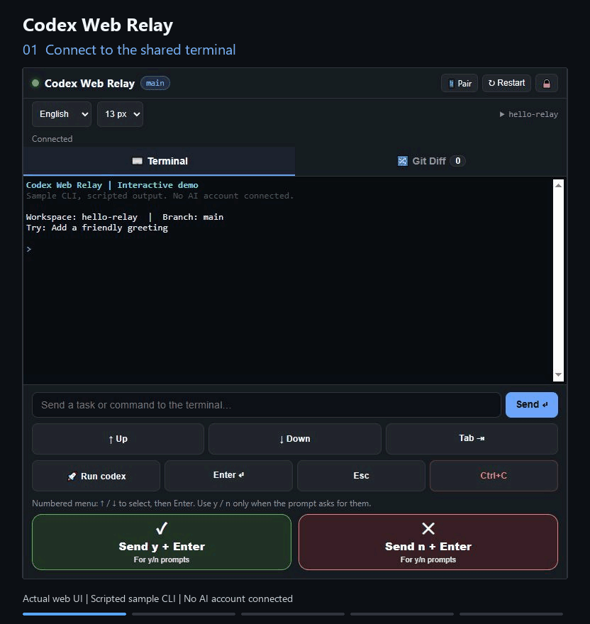

# Codex Web Relay

[English](README.md) | [简体中文](README.zh-CN.md)

Codex Web Relay (`codex-web-relay`) lets you follow a local Codex CLI session from your phone browser, send terminal input, and inspect Git changes. No mobile app installation is required. Relay provides a shared Web terminal, a mobile prompt bar, Git previews, and optional Cloudflare Tunnel connectivity.

**Local access only by default. No domain or Cloudflare account is needed to start.** This is an independent community project, not an official OpenAI product.

## Demo



A 13-second loop: send terminal input → read the prompt → confirm the sample edit → inspect Git Diff.

Captured from the actual Relay web UI with an isolated sample CLI and Git workspace. Terminal responses are scripted for this demonstration; no live Codex account, access credential, or pairing QR code is shown.

## Features and boundaries

- Authenticated terminal streaming using node-pty, WebSocket, and xterm.js.
- Prompt drafts stay until the server acknowledges writing them to the terminal. Uncertain retries reuse an input ID to reduce duplicate delivery.
- Shortcut buttons wait for a server acknowledgement and block rapid repeated clicks. Disconnection, failure and uncertain delivery are shown explicitly; shortcuts are never retried automatically.
- Git previews include staged/unstaged changes and untracked files inside new directories, including Unicode filenames.
- A local pairing page shows QR codes only for enabled LAN access or a registered public tunnel.
- Browser scripts/styles are served locally, without a third-party CDN.
- Optional temporary Cloudflare URLs, your own domain, or a dashboard-managed tunnel token.

**Send y + Enter** / **Send n + Enter** send `y` / `n` followed by Enter to whichever program is running. These are terminal shortcuts, not approvals bound to a particular Codex request. Read the terminal prompt before using them.

A numbered menu inside the terminal is rendered text, not an HTML button. Tapping its text does not necessarily select it. Use **↑ Up** / **↓ Down** to select, then **Enter** to confirm the highlighted option. **Tab** sends a tab key. Use the y/n shortcuts only when the program expects those keys.

## Requirements

- Node.js 22 or 24, npm, and Git on `PATH`.
- Codex CLI installed and signed in separately on the computer. Verify `codex --version` and a local session first; see the [official CLI instructions](https://developers.openai.com/codex/cli).
- Windows with ConPTY support, macOS, or Linux. Native `node-pty` installation may need platform build tools.
- Public tunnels additionally need cloudflared/network connectivity. Custom domains must belong to your Cloudflare account.

## Quick start: this computer

```bash
git clone https://github.com/lmjxff/codex-web-relay.git
cd codex-web-relay
npm ci
```

Copy the configuration:

```powershell
# Windows PowerShell
Copy-Item .env.example .env
```

```bash
# macOS / Linux
cp .env.example .env
```

In your local `.env`, set `CODEX_CWD` to your project's absolute path, such as `C:/work/my-project` or `/home/me/my-project`. If omitted, Relay uses its launch directory.

```bash
npm start
```

On first startup, a blank `RELAY_AUTH_TOKEN` is replaced with a random 256-bit credential saved in `.env`. The browser opens [the local pairing page](http://localhost:3210/qr). Follow its desktop-console link, or enter the credential in the login screen. Credentials are not printed to the console.

Defaults are `HOST=127.0.0.1` and `ENABLE_TUNNEL=false`: only this computer can connect, and no LAN/public QR code is generated. Keep the process running; Ctrl+C stops Relay.

For compiled JavaScript, use `npm run build` then `npm run serve`. `npm run dev` watches source changes. These instructions use a Git checkout and do not assume a published npm package.

## Connect a phone

### First sign-in

1. Keep Relay running on the computer. On that computer, open `http://localhost:3210/qr` (use your configured port if different).
2. Follow the desktop-console link for local use. For a phone, enable one of the modes below, then scan the corresponding pairing code. The default local-only mode intentionally has no LAN or public code.
3. If you need to enter a credential manually, open `.env` in the directory from which you launched Relay and use the value of `RELAY_AUTH_TOKEN`. It is saved locally and **not printed in terminal logs**. Do not paste it into Issues or screenshots. Legacy `RELAY_PIN` is only a fallback when no primary credential is set.
4. If the page cannot be reached at all, check the address, port, process and network first. If the page opens but login fails, check the credential from the running instance. A `429` response means the five-minute failure window is still active.

Choose a mode, edit **local `.env`**, and restart. Your personal domain does not belong in the committed example or README.

### Same trusted Wi-Fi

```dotenv
HOST=0.0.0.0
ENABLE_TUNNEL=false
```

Scan the LAN code on the computer's `http://localhost:3210/qr` page. Allow the port through the host firewall for your trusted private network. Guest Wi-Fi/client isolation may prevent connection. LAN HTTP is unencrypted; use only a network you trust.

With multiple network adapters, the suggested IP may be wrong. Open `http://YOUR_LAN_IP:3210/` manually on the phone and enter the credential instead.

### Temporary public URL: no domain required

```dotenv
HOST=127.0.0.1
ENABLE_TUNNEL=true
CF_HOSTNAME=
CF_TUNNEL_TOKEN=
```

Keep the generated long Relay credential. Relay waits for both a `*.trycloudflare.com` URL and a registered tunnel connection before offering a public QR code. Refresh local `/qr` and scan it. The URL can change each restart.

cloudflared may be downloaded during installation or when first needed. If a tunnel fails, local access remains available. Public reachability depends on your network and Cloudflare; see [Quick Tunnels](https://developers.cloudflare.com/cloudflare-one/networks/connectors/cloudflare-tunnel/do-more-with-tunnels/trycloudflare/).

### Your own domain: certificate mode

Authorize a Cloudflare domain you control:

```bash
npm run cf:login
```

Configure:

```dotenv
HOST=127.0.0.1
ENABLE_TUNNEL=true
CF_HOSTNAME=codex.example.com
CF_TUNNEL_NAME=codex-relay
CF_TUNNEL_TOKEN=
CF_OVERWRITE_DNS=false
```

Replace `codex.example.com` with **your own hostname**, without `https://`, a port, or a path. The certificate normally lives in `~/.cloudflared/cert.pem`. Relay creates/reuses a named tunnel and creates its Cloudflare DNS route. This mode changes your Cloudflare tunnel/DNS configuration.

Existing DNS records are preserved by default. Resolve a conflict yourself, or set `CF_OVERWRITE_DNS=true` if replacement is intended. Authorization/DNS failure leaves public access unavailable; it does not silently fall back to another domain.

If the named tunnel and its DNS route are already configured, set `CF_MANAGE_DNS=false` to reuse them. Relay then only checks the existing tunnel and starts its connector; it neither creates a tunnel nor changes DNS. A missing tunnel fails instead of falling back to creation. Confirm the hostname already points to that tunnel before connecting. `CF_OVERWRITE_DNS` has no effect in reuse mode.

### Dashboard-managed tunnel: token mode

Configure the published hostname in the Cloudflare dashboard and set its service URL to `http://127.0.0.1:3210` (adjust for a different `PORT`). Put its tunnel token in **local `.env` only**:

```dotenv
HOST=127.0.0.1
ENABLE_TUNNEL=true
CF_HOSTNAME=codex.example.com
CF_TUNNEL_TOKEN=<your-dashboard-tunnel-token>
```

Relay requires the configured hostname and does not create dashboard routes in this mode. The tunnel credential is passed via the child environment's `TUNNEL_TOKEN`, not command-line arguments. The Cloudflare tunnel token and the Relay browser credential are different secrets.

## Daily use and limits

While the page is in the foreground, Relay probes the connection every 15 seconds, with a 10-second response/connect deadline. Returning from the background or regaining network access checks liveness before enabling terminal input and requests the current shared screen. Reconnection waits 2, 4, 8, 16, then up to 30 seconds; a successful probe resets the delay. Offline/background pages wait for return. Browser suspension can delay timers. Drafts remain available for manual review/retry; commands and shortcut keys are never replayed automatically. A browser reconnect does not restart the host terminal.

The server also pings browser transports every 30 seconds and removes clients that miss the next check, releasing their shared terminal size. Upgrade/restart the server and refresh all browsers to enable both sides of recovery.

The language selector is available before and after sign-in. Chinese/English interface text and terminal font sizes (12/13/15/17 px) are saved in this browser. Switching them preserves the current connection and draft; it does not restart the terminal or translate program output. Expand the workspace name to view its full path.

**Restart** opens a confirmation dialog because it interrupts the shared session for every browser. **Cancel** leaves the session running. After upgrading, restart the Relay server when active work is finished, then refresh every connected browser so the new shortcut protocol is loaded on both sides.

1. **Send** keeps text during disconnection or until acknowledgement. An acknowledgement means the PTY accepted a write, not that Codex finished. Inspect the terminal before retrying uncertain delivery. Deduplication lasts up to five minutes with a bounded in-memory cache; it does not guarantee exactly-once delivery across server restarts.
2. **Git Diff** includes new directories and per-file filtering. Untracked files over 256 KiB are listed as omitted; binary files have no text preview. Overall Git output above 10 MiB can return an error. Use local Git for a complete review.

   Switching files cancels obsolete preview requests so late responses cannot replace your current selection. Automatic refresh leaves unchanged previews in place and preserves horizontal/vertical scrolling when the same file changes; selecting another file starts at the top. If a selected file leaves the change list, the filter returns to all changes.
3. **Restart** terminates the shared terminal and starts another. All browsers control the same session.
4. All connected browsers share the smallest reported viewport size. A desktop may become narrower while a phone is connected; this keeps cursor movement and menu redraws consistent. Reconnection and resizing restore the server's parsed current screen, with up to 1,000 scrollback lines. This bounded in-memory view is not persistent/full task history.
5. **Lock** removes this browser's saved credential. It does not revoke other browsers or rotate the server credential.
6. A normal exit, a reported failure, and a closed connection without an exit status are displayed separately. An unavailable exit code is not evidence that Codex crashed. Reconnecting a browser does not automatically replace an ended session; use **Restart** or **Run codex** explicitly. Restart clears the shared screen in all browsers.

## Configuration

`.env` is loaded from the **launch directory**. Existing process environment variables take precedence. See [`.env.example`](.env.example).

| Variable | Default | Meaning |
| --- | --- | --- |
| `HOST` | `127.0.0.1` | Bind address. `0.0.0.0` enables LAN; use loopback for tunnel-only access. |
| `PORT` | `3210` | HTTP/WebSocket port, 1–65535. |
| `RELAY_AUTH_TOKEN` | Generated locally | Shared access credential; 24+ characters for public tunnels. Single line, maximum 256 characters. Prefer the generated value. |
| `RELAY_PIN` | Unset | Legacy fallback when the main credential is empty. Short PINs are discouraged and cannot enable public tunnels. |
| `CODEX_CWD` | Launch directory | Absolute workspace path, ideally a Git working tree. |
| `CODEX_CMD` | `codex` | Trusted local shell command executed as the host user. |
| `AUTO_START_CODEX` | `true` | Automatically type the command into each new shell; `false` starts a shell only. |
| `AUTO_OPEN_QR` | `true` | Open the local pairing page after startup/tunnel setup. |
| `ENABLE_TUNNEL` | `false` | Explicitly enable cloudflared. |
| `CF_HOSTNAME` | Empty | Hostname you own; empty selects a temporary URL without a tunnel token. |
| `CF_TUNNEL_NAME` | `codex-relay` | Certificate-mode tunnel name. |
| `CF_TUNNEL_TOKEN` | Empty | Dashboard tunnel credential; requires a hostname. |
| `CF_OVERWRITE_DNS` | `false` | Permit replacing existing DNS in certificate mode. |
| `CF_MANAGE_DNS` | `true` | Certificate mode: `false` reuses an existing tunnel/DNS route without creating or modifying either. |

### Upgrade from 0.2.0

For an existing checkout, finish active work, stop Relay with Ctrl+C, and keep your local `.env`. Then run:

```bash
git pull --ff-only
npm ci
npm start
```

Refresh **every** connected browser after restarting so the client and server use the same screen protocol. Version 0.2.2 adds runtime dependencies for shared screen restoration.

- Remove the former author's domain from local `.env`. Leave the hostname blank for a temporary tunnel, or use a domain you control.
- The new defaults allow local access only. An existing `.env` keeps its explicit `HOST`/`ENABLE_TUNNEL` choices; copying defaults does not override process environment variables.
- To rotate an old short PIN, stop Relay, clear `RELAY_AUTH_TOKEN` and remove `RELAY_PIN` from local `.env`/process environment, then restart to generate a long credential. Previous links/browser logins stop working after rotation and restart.
- Public tunnels require 24+ character Relay credentials. Do not publish `/qr` screenshots, credential-bearing URLs, or `.env`.

## Security model

**Authenticated browsers control a real shell with the host user's permissions.** Relay does not sandbox the shell or restrict it to Codex/Git commands. Use an unprivileged account and a workspace you intend to expose. Codex's own execution policies do not protect the surrounding shell.

Credentials have no automatic expiry. QR codes/URLs contain the credential; browsers store it in localStorage. Removing the query token from the visible address bar does not erase browser history, proxy logs, or copied URLs. Use trusted devices and HTTPS for public access. Rotate a leaked credential and restart Relay to close existing sessions.

Local `/qr` bypasses login only for loopback connections with a local Host and no forwarded headers. Other requests require authentication. HTTP APIs and WebSocket upgrades authenticate; eight failures block an address for the remainder of a five-minute window. Forwarded headers from direct clients cannot select a different rate-limit bucket. Cloudflare client IPs are trusted only from loopback with tunnel mode enabled; do not place an untrusted local proxy in that boundary. Rate limiting supplements a strong credential.

Normal shutdown attempts to stop the terminal/tunnel and close clients. Forced kills or OS crashes are outside that cleanup guarantee; inspect for remaining cloudflared processes after recovery. See [SECURITY.md](SECURITY.md).

## API overview

Scripts should prefer `Authorization: Bearer <relay-credential>` or `x-relay-token: <relay-credential>` over query tokens. Use HTTPS remotely and remove credentials from issue reports.

| Endpoint | Purpose |
| --- | --- |
| `POST /api/auth/verify` | Rate-limited verification: JSON `{ "token": "<relay-credential>" }`. |
| `GET /api/health` | Authenticated terminal/workspace/tunnel status. |
| `GET /api/qr` | Authenticated pairing payload, including the credential. Unavailable public/LAN URLs are `null`. |
| `GET /api/git/status` | Authenticated branch and per-file status. |
| `GET /api/git/diff?file=<encoded-path>` | Authenticated raw/HTML preview, `hasChanges`, `omittedFiles`; optional file filter. |
| `POST /api/action` | Authenticated `action`: `approve`, `reject`, `enter`, `esc`, `ctrl_c`, `start_codex`, `up`, `down`, `tab`. |
| `/ws` | Authenticated stream; browser query token or script auth header. Foreign browser origins are rejected. |

WebSocket outputs include `status`, `history`, `output`, and `session-reset`. History/reset messages carry the shared `cols`/`rows`; clients must apply them in order with terminal writes. Ended status includes `kind` (`normal`, `error`, `unknown`) and nullable `exitCode`/`signal`. Send `{ "type": "input", "id": "<unique-id>", "data": "..." }` for `input-ack`/`input-error` with that ID. Input limit: 16 Ki characters; frame limit: 128 KiB. Direct keystrokes without IDs remain supported. Other messages: `resize`, `action`, `restart`, `ping`.

## Troubleshooting

For liveness, send `{ "type": "ping", "id": "<probe-id>" }`; the server echoes the ID in `pong`. `{ "type": "sync" }` returns the current `status` and parsed `history` without starting a new terminal or sending input.

Shortcut messages may include an ID: `{ "type": "action", "id": "<unique-id>", "action": "enter" }`. The server replies with `action-ack` or `action-error`. An acknowledgement means the key was written to the PTY, not that the running program finished or approved a request. Duplicate IDs for the same key are suppressed for up to five minutes in a bounded in-memory cache; restarting clears it. Lost acknowledgements are reported as uncertain delivery; inspect the terminal before pressing again. Refresh every browser after upgrading both server and client.

| Symptom | Check |
| --- | --- |
| Cannot find a credential in terminal output | This is intentional. Use the local `/qr` page or `RELAY_AUTH_TOKEN` in the launch directory's `.env`; check the running instance rather than a different checkout. |
| Pairing page has no phone code | Defaults allow local access only. Enable LAN or a ready public tunnel first. A missing public code can also mean the tunnel is not connected. |
| Shortcut reports uncertain delivery | Inspect the terminal before pressing again. The key may have been written even if its acknowledgement was lost; it is never retried automatically. |
| Native install fails | Use Node 22/24. Source builds need Python and C++ tools: Visual Studio Build Tools on Windows, Command Line Tools on macOS, make/G++ on Linux. See [node-pty prerequisites](https://github.com/microsoft/node-pty#dependencies). |
| macOS reports `posix_spawnp failed` | Relay repairs missing execute bits on node-pty's known helper files at startup ([upstream defect](https://github.com/microsoft/node-pty/issues/919)). Install dependencies under your own user so they are writable; check shell/workspace paths if the error persists. |
| `codex` missing in terminal | Check the host user's PATH, CLI installation/sign-in, and `CODEX_CMD`. Run locally first. |
| Git status fails | Check Git installation, permissions, and that `CODEX_CWD` is a Git working tree. |
| LAN phone cannot connect | Check `HOST`, LAN IP, firewall, same network, and Wi-Fi client isolation. |
| No public QR | Check tunnel opt-in, long Relay credential, cloudflared connectivity, authorization/DNS routes; refresh `/qr`. |
| Login returns 429 | Wait for the five-minute failure window; check the credential locally. |
| Restart interrupts work | This is one shared in-memory terminal, not a persistent task scheduler. |
| Approval text remains on another screen | Restart Relay after updating, refresh every browser to load the new client, and verify both use the shared geometry. Terminal menu text is not a clickable web button; confirm the highlighted option with Enter. Report remaining redraw issues with OS/browser details and redacted screenshots. |

## Development and verification

```bash
npm ci --ignore-scripts
npm rebuild node-pty
npm test
npm pack --dry-run
```

Tests cover Git fixtures, authentication/rate limits, HTTP/WebSocket behavior, draft acknowledgement/reconnection, PTY lifecycle, a harmless native command, and simulated tunnel/DNS lifecycle. They do not create real DNS records, open public tunnels, or log into Codex. CI targets Windows/macOS/Linux with Node 22/24; consult the actual workflow result. Phone browsers, Codex interactive prompts, and public network reachability need separate end-to-end checks.

[Contributing](CONTRIBUTING.md) · [Changelog](CHANGELOG.md) · [MIT license](LICENSE)
